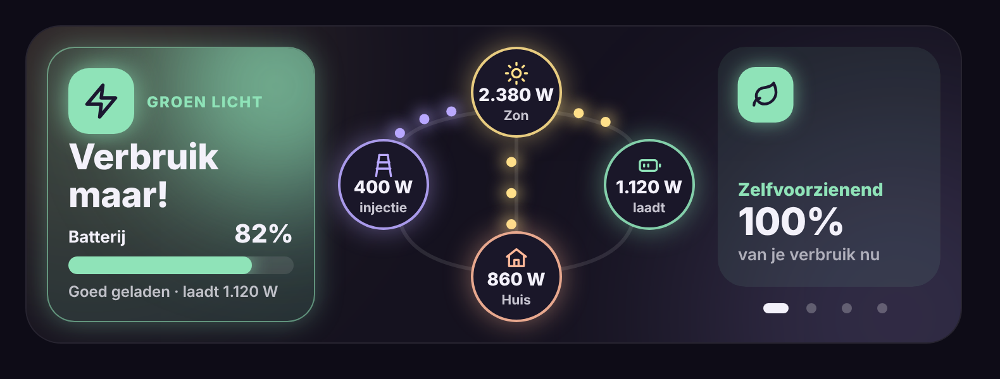

# Glow Energy Card

🇬🇧 English · 🇳🇱 [Nederlands](README.nl.md)

A Home Assistant dashboard card for solar panels, a home battery and the grid. Its main job: tell you **from across the room** whether now is a good moment to start the washing machine.



## Features

- **Advice panel** in three colours, each with its own icon:
  - 🟢 **Go ahead!** – there's a surplus (export + battery charging) of at least 1500 W, or the battery is full and the sun covers the house.
  - 🟡 **Small appliances OK** – the sun roughly covers the house, or the battery is at least 40 % charged.
  - 🔴 **Better wait** – power comes from the grid.
  - The advice only changes after it has been stable for 60 seconds, so it doesn't flicker. All thresholds are configurable.
- **Battery bar** with percentage and status (full, well charged, half charged, almost empty).
- **Energy flow diagram**: solar, grid, battery and home, with glowing dots that run faster as more power flows.
- **Home usage is calculated** (solar + grid − battery) unless you give a sensor for it.
- **Swipeable tiles**: one tile at a time, endless scrolling, dots to jump, optional automatic rotation. Any sensor can be a tile, plus a built-in self-sufficiency tile.
- **Units**: always W/Wh, or automatic kW/kWh for large values.
- Tap a node or tile to open the entity's details.
- **Wide and low** (two columns on a tablet), automatically stacked when the card is narrow.
- **Visual editor** and **six languages** (English, Dutch, French, German, Spanish, Italian).

## Installation via HACS

1. Open **HACS** → three dots top right → **Custom repositories**.
2. Repository: `https://github.com/stijnleroy/glow-energy-card`, type **Dashboard** → **Add**.
3. Search **Glow Energy Card** → **Download**, then reload your browser.

## Usage

```yaml
type: custom:glow-energy-card
solar: sensor.inverter_input_power
grid: sensor.p1_meter_vermogen                     # positive = import
battery: sensor.battery_charge_discharge_power     # positive = charging
battery_soc: sensor.battery_state_of_capacity
auto_rotate: 10
tiles:
  - type: self_sufficiency
  - entity: sensor.inverter_daily_yield
    name: Solar today
    icon: sun
    secondary: sensor.energy_production_tomorrow
    secondary_name: "tomorrow ±"
  - entity: sensor.p1_meter_piekverbruik_huidige_maand
    name: Peak this month
    icon: peak
  - entity: sensor.battery_day_charge
    name: Battery today
    icon: battery
    sign: true
    secondary: sensor.battery_day_discharge
    secondary_name: "discharged"
```

### Card options

| Option | Default | Description |
|---|---|---|
| `solar` | – | Solar power sensor (W or kW). |
| `grid` | – | Grid power sensor. Positive = import, negative = export. |
| `battery` | – | Battery power sensor. Positive = charging, negative = discharging. |
| `battery_soc` | – | Battery state of charge (%). |
| `house` | calculated | Home usage sensor. Leave empty to calculate solar + grid − battery. |
| `invert_grid` / `invert_battery` | `false` | Flip the sign if your sensor uses the opposite convention. |
| `units` | `w` | `w` = always W and Wh, `auto` = kW and kWh for values of 1000 and up. |
| `surplus` | `1500` | Surplus in W needed for the green advice. |
| `soc_ok` | `40` | Battery % for the yellow advice. |
| `soc_full` | `90` | Battery % counted as full. |
| `advice_delay` | `60` | Seconds a new advice must hold before it is shown (0 = immediately). |
| `auto_rotate` | `0` | Seconds between tiles (0 = off; swipe manually). |
| `glow` | `22` | Glow strength in pixels. |
| `height` | `218` | Content height in pixels. |
| `language` | automatic | `en`, `nl`, `fr`, `de`, `es` or `it`. |
| `tiles` | – | List of tiles (below). |

### Tile options

| Option | Description |
|---|---|
| `type` | `self_sufficiency` for the built-in tile; leave out for a sensor tile. |
| `entity` | Sensor to show. Power and energy follow the `units` setting. |
| `name` | Title of the tile. |
| `icon` | `sun`, `battery`, `grid`, `home`, `bolt`, `leaf`, `peak`, `arrow`, or any `mdi:` icon. |
| `color` | Tile colour, e.g. `"#FFE08A"`. |
| `sign` | `true` to show + or − in front of the value. |
| `secondary` / `secondary_name` | Second sensor shown under the value, with a text in front. |
| `sub` | Fixed caption under the value (when there is no second sensor). |

## License

MIT
