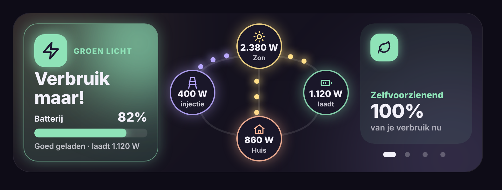

# Glow Energy Card

🇬🇧 [English](README.md) · 🇳🇱 Nederlands

Een dashboardkaart voor Home Assistant voor zonnepanelen, thuisbatterij en net. Vooral: je ziet **van ver** of het een goed moment is om de wasmachine aan te zetten.



## Wat kan de kaart?

- **Adviesvak** in drie kleuren, elk met een eigen icoon:
  - 🟢 **Verbruik maar!** – er is minstens 1500 W over (injectie + wat de batterij laadt), of de batterij is vol en de zon dekt het huis.
  - 🟡 **Kleine toestellen oké** – de zon dekt ongeveer het huis, of de batterij is minstens 40 % geladen.
  - 🔴 **Liever later** – de stroom komt van het net.
  - Het advies wisselt pas als het 60 seconden stabiel is, zodat het niet heen en weer springt. Alle drempels zijn instelbaar.
- **Batterijbalk** met percentage en status (vol, goed geladen, half geladen, bijna leeg).
- **Stroomschema**: zon, net, batterij en huis, met gloeiende bolletjes die sneller lopen naarmate er meer vermogen vloeit.
- **Thuisverbruik wordt berekend** (zon + net − batterij), tenzij je er zelf een sensor voor opgeeft.
- **Swipebare tegels**: één tegel tegelijk, eindeloos scrollen, bolletjes om te springen en optioneel automatisch wisselen. Elke sensor kan een tegel worden, plus een ingebouwde tegel "Zelfvoorzienend".
- **Eenheden**: altijd W/Wh, of automatisch kW/kWh bij grote getallen.
- Tik op een bol of tegel om de details van de sensor te openen.
- **Breed en laag** (twee kolommen op een tablet); in een smalle kolom automatisch onder elkaar.
- **Visuele editor** en **zes talen** (Nederlands, Engels, Frans, Duits, Spaans, Italiaans).

## Installeren via HACS

1. Open **HACS** → drie puntjes rechtsboven → **Custom repositories**.
2. Repository: `https://github.com/stijnleroy/glow-energy-card`, type **Dashboard** → **Add**.
3. Zoek **Glow Energy Card** → **Download** en herlaad je browser.

## Gebruik

```yaml
type: custom:glow-energy-card
solar: sensor.inverter_input_power
grid: sensor.p1_meter_vermogen                     # positief = afname
battery: sensor.battery_charge_discharge_power     # positief = laden
battery_soc: sensor.battery_state_of_capacity
auto_rotate: 10
tiles:
  - type: self_sufficiency
  - entity: sensor.inverter_daily_yield
    name: Zon vandaag
    icon: sun
    secondary: sensor.energy_production_tomorrow
    secondary_name: "morgen ±"
  - entity: sensor.p1_meter_piekverbruik_huidige_maand
    name: Piek deze maand
    icon: peak
    sub: capaciteitstarief
  - entity: sensor.battery_day_charge
    name: Batterij vandaag
    icon: battery
    sign: true
    secondary: sensor.battery_day_discharge
    secondary_name: "ontladen"
```

### Opties van de kaart

| Optie | Standaard | Uitleg |
|---|---|---|
| `solar` | – | Vermogen van de zonnepanelen (W of kW). |
| `grid` | – | Vermogen van het net. Positief = afname, negatief = injectie. |
| `battery` | – | Vermogen van de batterij. Positief = laden, negatief = ontladen. |
| `battery_soc` | – | Batterijpercentage. |
| `house` | berekend | Sensor voor het thuisverbruik. Leeg = zon + net − batterij. |
| `invert_grid` / `invert_battery` | `false` | Teken omdraaien als je sensor het andersom doet. |
| `units` | `w` | `w` = altijd W en Wh, `auto` = kW en kWh vanaf 1000. |
| `surplus` | `1500` | Overschot in W voor het groene advies. |
| `soc_ok` | `40` | Batterij-% voor het gele advies. |
| `soc_full` | `90` | Vanaf dit % telt de batterij als vol. |
| `advice_delay` | `60` | Aantal seconden dat een nieuw advies moet aanhouden voor het getoond wordt (0 = meteen). |
| `auto_rotate` | `0` | Seconden tussen de tegels (0 = uit, zelf swipen). |
| `glow` | `22` | Sterkte van de gloed in pixels. |
| `height` | `218` | Hoogte van de inhoud in pixels. |
| `language` | automatisch | `nl`, `en`, `fr`, `de`, `es` of `it`. |
| `tiles` | – | Lijst met tegels (zie hieronder). |

### Opties per tegel

| Optie | Uitleg |
|---|---|
| `type` | `self_sufficiency` voor de ingebouwde tegel; weglaten voor een sensortegel. |
| `entity` | De sensor die getoond wordt. Vermogen en energie volgen de instelling `units`. |
| `name` | Titel van de tegel. |
| `icon` | `sun`, `battery`, `grid`, `home`, `bolt`, `leaf`, `peak`, `arrow` of eender welk `mdi:`-icoon. |
| `color` | Kleur van de tegel, bv. `"#FFE08A"`. |
| `sign` | `true` om + of − voor de waarde te tonen. |
| `secondary` / `secondary_name` | Tweede sensor onder de waarde, met een tekst ervoor. |
| `sub` | Vaste uitleg onder de waarde (als er geen tweede sensor is). |

## Licentie

MIT
